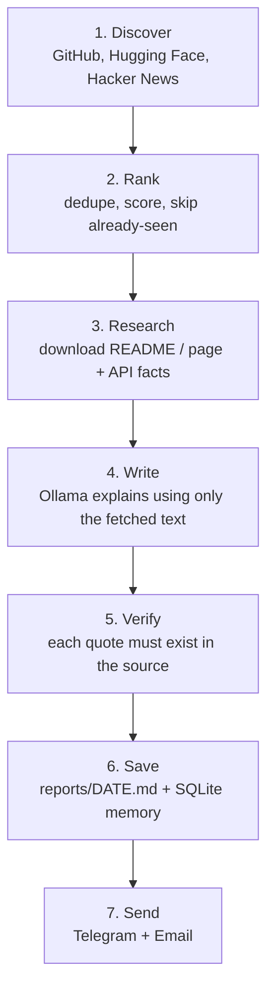

# AI/ML Daily Trends Agent

A small, free, local AI agent that finds trending AI/ML tools every day, reads their real documentation, writes a simple explanation with a local LLM (Ollama), **checks every claim against the source**, and sends the digest to Telegram and email.

> Core idea: **don't let the model decide what's true.** Code fetches the facts, the model only explains them, and code double-checks the result.

<!--
Add a screenshot of your Telegram digest here (blur personal info):

-->

---

## Features

- **Finds new tools automatically** from GitHub, Hugging Face and Hacker News (all free APIs, no paid keys).
- **Ranks by trend velocity**, merges duplicates across platforms, and never repeats a tool you already received.
- **Reads the real source** (README / model card / web page) instead of answering from model memory.
- **Runs 100% locally** with [Ollama](https://ollama.com). No paid LLM API.
- **Claim verification:** every claim the model makes must include an exact quote, and the code checks that the quote really exists in the source. Entries are marked `verified`, `partial`, or dropped.
- **Delivers daily** to Telegram and Gmail, and saves a markdown archive in `reports/`.
- Plain Python, SQLite, and three small dependencies. Easy to read and modify.

## How it works



| Step | File | What happens |
|---|---|---|
| Discover | `sources.py` | Pulls candidates from the three sources |
| Rank | `ranker.py` | Percentile score per source, bonus for appearing on several platforms, removes tools already sent |
| Research | `researcher.py` | Fetches the README or page; stars, license and dates come from APIs, never from the model |
| Write | `writer.py`, `llm.py` | Asks Ollama for structured JSON using only the fetched text |
| Verify | `verifier.py` | Checks each claim's quote against the source |
| Save / Send | `publisher.py`, `db.py` | Builds the digest, saves it, remembers sent tools, sends Telegram and email |
| Control | `main.py`, `config.py` | Runs the pipeline; holds all settings |

## Project structure

```
ai-trends-agent/
├── main.py            # Entry point, runs the whole pipeline
├── config.py          # Settings, keyword filters, source weights
├── models.py          # Candidate data structure
├── net.py             # Safe HTTP helper
├── sources.py         # GitHub / Hugging Face / Hacker News fetchers
├── ranker.py          # Dedup and ranking
├── researcher.py      # Fetches source text and facts
├── llm.py             # Talks to Ollama
├── writer.py          # Prompt + structured output
├── verifier.py        # Claim verification
├── db.py              # SQLite memory (trends.db)
├── publisher.py       # Telegram, email, markdown archive
├── RunDigest.command  # Double-click launcher for macOS
├── requirements.txt
├── .env.example       # Template for your private settings
└── reports/           # Daily digests (created automatically)
```

---

## Setup (step by step)

### Requirements

- Python **3.9 or newer**
- [Ollama](https://ollama.com) installed
- **8 GB RAM minimum, 16 GB recommended** (for a 7B model)
- A Telegram account and/or a Gmail account (both free)

### 1. Clone the project

```bash
git clone https://github.com/harsh13exe/ai-trends-agent.git
cd ai-trends-agent
```

### 2. Install Ollama and download a model

1. Download Ollama from https://ollama.com and install it.
2. Open the Ollama app (it must be running in the background).
3. Download the model:

```bash
ollama pull qwen2.5:7b-instruct
```

This is about 5 GB. On a smaller machine you can use `qwen2.5:3b` instead (faster, slightly less accurate). Test that it works:

```bash
ollama run qwen2.5:7b-instruct "Say hello"
```

### 3. Create a virtual environment and install dependencies

**macOS / Linux**
```bash
python3 -m venv venv
source venv/bin/activate
pip install -r requirements.txt
```

**Windows (PowerShell)**
```powershell
python -m venv venv
venv\Scripts\activate
pip install -r requirements.txt
```

### 4. Create your `.env` file

```bash
cp .env.example .env        # Windows: copy .env.example .env
```

Open `.env` and fill in the values. Each one is explained below. **Never commit this file** (it is already listed in `.gitignore`).

```env
OLLAMA_URL=http://localhost:11434
OLLAMA_MODEL=qwen2.5:7b-instruct
TOP_N=5
GITHUB_TOKEN=
TELEGRAM_BOT_TOKEN=
TELEGRAM_CHAT_ID=
EMAIL_USER=
EMAIL_APP_PASSWORD=
EMAIL_TO=
```

| Variable | Required | Meaning |
|---|---|---|
| `OLLAMA_URL` | Yes | Where Ollama runs. Keep the default |
| `OLLAMA_MODEL` | Yes | Model name used to write summaries |
| `TOP_N` | No | Tools per day (default 5) |
| `GITHUB_TOKEN` | No | Free token that raises GitHub's rate limit. See step 5 |
| `TELEGRAM_BOT_TOKEN`, `TELEGRAM_CHAT_ID` | For Telegram | See step 6 |
| `EMAIL_USER`, `EMAIL_APP_PASSWORD`, `EMAIL_TO` | For email | See step 7 |

If you leave Telegram or email blank, that channel is skipped, and the digest is still saved to `reports/`.

### 5. (Optional) GitHub token

Without a token GitHub allows few requests per hour. To avoid warnings:

1. Go to GitHub > **Settings > Developer settings > Personal access tokens > Tokens (classic)**.
2. Click **Generate new token**. You don't need to tick any scopes for public data.
3. Paste it into `GITHUB_TOKEN` in `.env`.

### 6. Set up Telegram (free)

1. In Telegram, search for **@BotFather** and send `/newbot`.
2. Choose a name and username. BotFather replies with a **token**. Put it in `TELEGRAM_BOT_TOKEN`.
3. Open your new bot in Telegram and send it any message (for example "hello"). This step is required.
4. Open this URL in your browser (replace `<TOKEN>` with your token):
   `https://api.telegram.org/bot<TOKEN>/getUpdates`
5. Find `"chat":{"id": 123456789 ...` and copy the number into `TELEGRAM_CHAT_ID`.

### 7. Set up Gmail (free)

Gmail does not allow your normal password for scripts, so you create an App Password:

1. Turn on **2-Step Verification** in your Google account.
2. Go to https://myaccount.google.com/apppasswords and create an app password (name it anything).
3. Copy the 16-character password into `EMAIL_APP_PASSWORD`.
4. Set `EMAIL_USER` to your Gmail address and `EMAIL_TO` to where you want to receive the digest (it can be the same address).

---

## Run it

Make sure the **Ollama app is running**, and your virtual environment is active.

**Test run (saves a report, sends nothing):**
```bash
python main.py --no-send --top 2
```

**Full run (saves + Telegram + email):**
```bash
python main.py
```

**Choose how many tools:**
```bash
python main.py --top 8
```

A run takes roughly 10-20 minutes on a laptop CPU, because the local model writes each entry. Your report appears in `reports/YYYY-MM-DD.md`.

> **Note:** even a `--no-send` run marks the tools as "already seen". To start fresh after testing, delete `trends.db`.

### Example output

```
1. owner/some-new-tool  [Verified]
Short plain-language summary of what it is.

Why it matters: ...
Who should use it: ...
Quick start: ...

Pros:
  - ...
Cons:
  - ...
Alternatives (model's suggestion, unverified):
  - ...

Sources:
  - https://github.com/owner/some-new-tool
```

---

## Run it daily

### Easiest: double-click (macOS)

`RunDigest.command` is included. Open Ollama, then double-click the file. The first time, right-click > **Open** > **Open** to allow it. If it isn't executable, run `chmod +x RunDigest.command` once.

### Automatic: macOS (launchd)

Runs a check every 30 minutes and sends the digest once per day after 9 AM, even if the laptop was asleep earlier. Create `run_daily.py` in the project folder:

```python
import sys
from datetime import datetime
import requests
import config
import main

now = datetime.now()
marker = config.BASE_DIR / f".done-{now:%Y-%m-%d}"

if now.hour < 9 or marker.exists():
    sys.exit(0)
try:
    requests.get(config.OLLAMA_URL, timeout=5)
except Exception:
    print("Ollama is not running yet, will retry later")
    sys.exit(0)

main.run(send=True, top_n=config.TOP_N)
marker.write_text("done")
```

Then, from the project folder:

```bash
cat > ~/Library/LaunchAgents/com.aitrends.daily.plist <<EOF
<?xml version="1.0" encoding="UTF-8"?>
<!DOCTYPE plist PUBLIC "-//Apple//DTD PLIST 1.0//EN" "http://www.apple.com/DTDs/PropertyList-1.0.dtd">
<plist version="1.0">
<dict>
  <key>Label</key><string>com.aitrends.daily</string>
  <key>ProgramArguments</key>
  <array>
    <string>$(pwd)/venv/bin/python</string>
    <string>$(pwd)/run_daily.py</string>
  </array>
  <key>WorkingDirectory</key><string>$(pwd)</string>
  <key>RunAtLoad</key><true/>
  <key>StartInterval</key><integer>1800</integer>
  <key>StandardOutPath</key><string>$(pwd)/run.log</string>
  <key>StandardErrorPath</key><string>$(pwd)/run.log</string>
</dict>
</plist>
EOF
launchctl bootstrap gui/$(id -u) ~/Library/LaunchAgents/com.aitrends.daily.plist
```

Also enable **Launch at login** in Ollama's settings. To stop it later:
`launchctl bootout gui/$(id -u) ~/Library/LaunchAgents/com.aitrends.daily.plist`

### Automatic: Linux (cron)

```bash
crontab -e
# add this line (runs at 9:00 every day):
0 9 * * * cd /path/to/ai-trends-agent && venv/bin/python main.py >> run.log 2>&1
```

### Automatic: Windows (Task Scheduler)

1. Open **Task Scheduler > Create Task**.
2. Trigger: **Daily** at your chosen time.
3. Action: **Start a program** with program `venv\Scripts\python.exe`, arguments `main.py`, and "Start in" set to the project folder.
4. In **Settings**, tick *Run task as soon as possible after a scheduled start is missed*.

> A closed or sleeping laptop cannot run the job. It will run when the laptop is awake again (with the launchd / Task Scheduler options above).

---

## Configuration

Edit `config.py` to customise:

| Setting | What it controls |
|---|---|
| `HN_QUERIES` | Search words used on Hacker News |
| `GITHUB_TERMS` | Search words used on GitHub |
| `is_relevant` keywords | What counts as AI/ML-related |
| `SOURCE_WEIGHT` | How much each source is trusted in ranking |
| `MAX_SOURCE_CHARS` | How much source text the model reads per tool |
| `NUM_CTX` | Context window sent to Ollama |

## How accuracy is protected

- Stars, license, language and dates come from platform APIs, not from the model.
- The model is instructed to use **only** the fetched text and to write "Not stated in the source" when unsure.
- Each claim must include an exact quote, and `verifier.py` checks that the quote exists in the source.

| Verified claims | Status | Result |
|---|---|---|
| 80% or more | `verified` | Included with a check mark |
| 50% to 79% | `partial` | Included with a warning mark |
| Below 50% | `rejected` | Dropped |

## Troubleshooting

| Problem | Fix |
|---|---|
| Nothing happens / connection error | Ollama isn't running. Open the Ollama app and retry |
| Very slow | Normal on CPU. Use `--top 3` or a smaller model such as `qwen2.5:3b` |
| `No verified items today` | All candidates were rejected or already sent. Delete `trends.db` if you were only testing |
| No Telegram message | Check the token and chat ID, and make sure you sent your bot a message first |
| Email fails | Use a Gmail **App Password**, with 2-Step Verification on |
| GitHub rate-limit warnings | Add a `GITHUB_TOKEN` in `.env` |
| Off-topic tools appear | Known limitation, see below. Tighten the keywords in `config.py` |
| `command not found: python` | Use `python3`, or activate the virtual environment first |

## Known limitations

- The verifier proves that a quote exists in the source, not that it fully supports the claim.
- The "Alternatives" list comes from the model's memory and is labelled unverified.
- The AI/ML keyword filter is simple, so occasional off-topic tools can appear.
- Small local models can write awkward sentences even when the facts are correct.
- Only three sources are covered so far.

## Roadmap

- [ ] Stricter AI/ML relevance filter (GitHub topics + LLM yes/no check)
- [ ] LLM judge that checks each quote truly supports its claim
- [ ] More sources: official company blogs (RSS), Reddit
- [ ] Release watchlist for major updates to existing tools
- [ ] Telegram feedback buttons that adjust ranking
- [ ] Accuracy test set with measured results

## Tech stack

Python, Ollama (Qwen 2.5), SQLite, `requests`, `beautifulsoup4`, `python-dotenv`, Telegram Bot API, Gmail SMTP.

## Contributing

Issues and pull requests are welcome. For larger changes, please open an issue first to discuss what you'd like to change.

## Author

Built by [Harsh Dhiman](https://github.com/harsh13exe).
